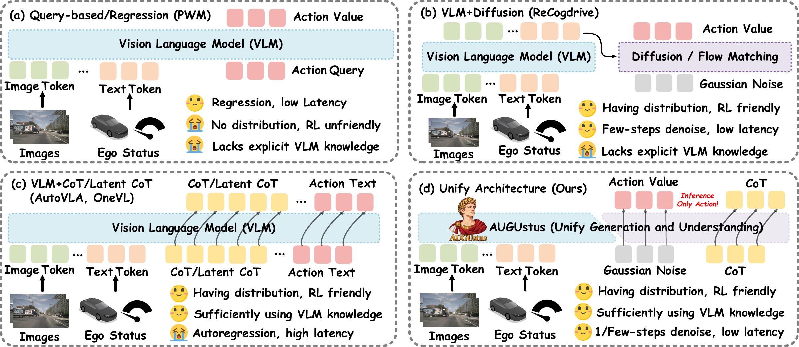
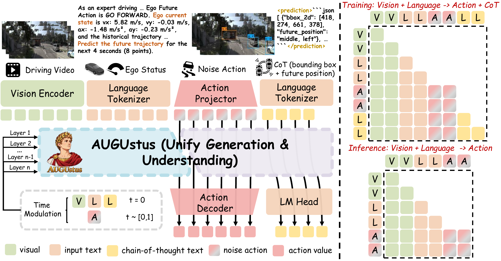
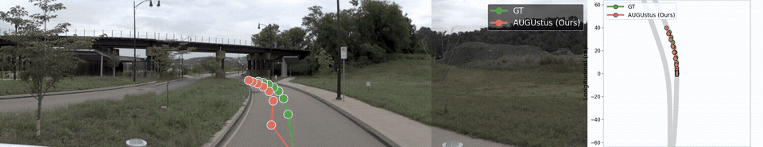
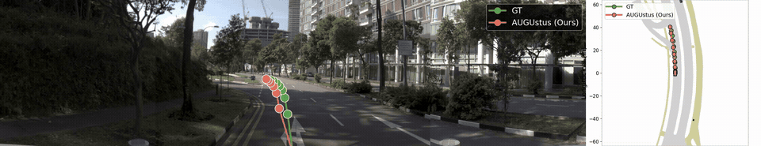
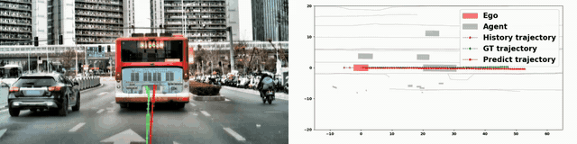
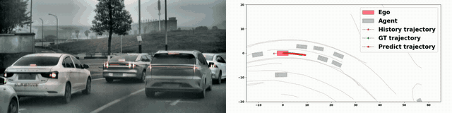
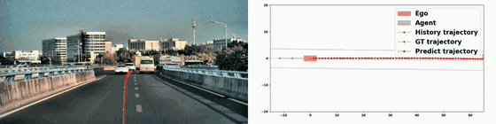
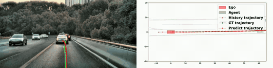
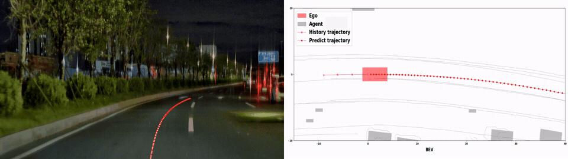
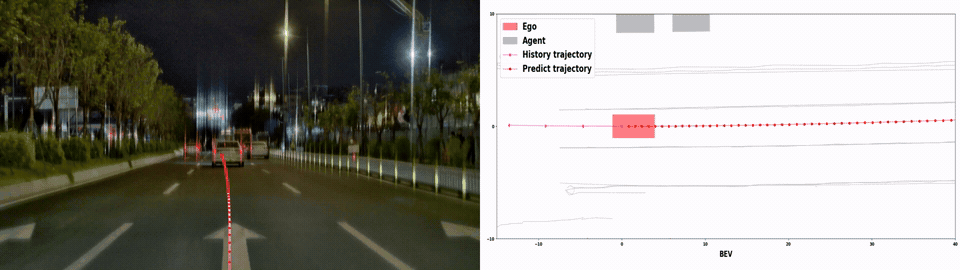

<h1 align="center"> AUGUstus</h1>
<h3 align="center"><ins>A</ins>utonomous Driving VLA Model with<br><ins>U</ins>nified <ins>G</ins>eneration and <ins>U</ins>nderstanding</h3>

<p align="center">
  Yuqi Ye<sup>1,*</sup> &nbsp; Caigao JIANG<sup>2,‡</sup> &nbsp; Zhuonan Wang<sup>3</sup> &nbsp; Congyuan Pei<sup>2</sup> &nbsp; Chao Qu<sup>3</sup><br>
  Changhao Peng<sup>1</sup> &nbsp; Junhong Lin<sup>1</sup> &nbsp; Qize Yu<sup>1</sup> &nbsp; Zetian Song<sup>1</sup> &nbsp; Guangzhao Fu<sup>2</sup><br>
  Chongruo Wu<sup>2</sup> &nbsp; Shiyu Huang<sup>2</sup> &nbsp; Shuchang Zhou<sup>2</sup> &nbsp; Honggou Yang<sup>2</sup> &nbsp; Wei Gao<sup>1,†</sup>
</p>
<p align="center">
  <sup>*</sup> <b>First Author</b> &nbsp; · &nbsp;
  <sup>‡</sup> <b>Project lead</b> &nbsp; · &nbsp;
  <sup>†</sup> <b>Corresponding Author</b>
</p>

<p align="center">
   &nbsp;&nbsp;
   &nbsp;&nbsp;
  <br>
  <sub><sup>1</sup> Peking University · <sup>2</sup> XPeng Motors · <sup>3</sup> Fudan University</sub>
</p>
<p align="center">
  <a href="https://arxiv.org/pdf/2610.16985"></a> &nbsp;
  <a href="https://github.com/haha-yuki-haha/AUGUstus"></a> &nbsp;
  <a href="https://huggingface.co/yuki-hahaha/AUGUstus"></a>
</p>
<p align="center"><b>🌐 Project Page:</b> <a href="https://augustus-ad.github.io/">https://augustus-ad.github.io/</a></p>
<p align="center"><a href="#overview">Overview</a> · <a href="#benchmarks-and-runtime">Results</a> · <a href="#installation">Installation</a> · <a href="#data-preparation">Data</a> · <a href="#supervised-fine-tuning">SFT</a> · <a href="#grpo-post-training">GRPO</a> · <a href="#inference-and-evaluation">Inference</a> · <a href="#code-guide">Code Guide</a> · <a href="#visualizations">Visualizations</a> · <a href="#contact">Contact</a></p>

<p align="center"></p>

<a id="about-this-repository"></a>

## 🚗 About This Repository

This repository contains the AUGUstus model, data processing, supervised fine-tuning, GRPO post-training, and NAVSIM evaluation code. The workflow is **data preparation → SFT → GRPO Stage I → GRPO Stage II → evaluation**.

**🏋️ 512 NVIDIA H800 GPUs for ~2 days · 318K+ hours of driving video · 513B+ training tokens.** We demonstrated **⚡ 12 Hz on-vehicle deployment** in preliminary real-world driving tests.

- **[AUGUstus_SFT](AUGUstus_SFT/)** provides the shared model, action/CoT training, HF dataset caches, checkpoint loading, and inference tools.
- **[AUGUstus_GRPO](AUGUstus_GRPO/)** reuses the SFT model and datasets, and adds rollout sampling, action/CoT losses, reward computation, and verl-based training.

The code primarily targets NAVSIM. For training, prepare the data and Qwen3.5-2B backbone described in [Data Preparation](#data-preparation). For evaluation, use a trained AUGUstus checkpoint.

<a id="overview"></a>

## 📖 Overview

<a id="figure-1"></a>
<p align="center"><a href="assets/paper-figures/a26.png"></a></p>
<p align="center"><b>Figure 1.</b> The difference between AUGUstus and other autonomous-driving VLA paradigms.</p>

<a id="figure-2"></a>
<p align="center"><a href="assets/paper-figures/a27.png"></a></p>
<p align="center"><b>Figure 2.</b> Overview of AUGUstus.</p>

<a id="benchmarks-and-runtime"></a>

## 📊 Benchmarks and Runtime

### NAVSIM v1

<a id="table-1"></a>
<p align="center"><b>Table 1.</b> Performance comparison on NAVSIM v1.</p>
<table align="center">
  <thead><tr><th>Method</th><th>Ref.</th><th>RL</th><th>NC ↑</th><th>DAC ↑</th><th>EP ↑</th><th>TTC ↑</th><th>Comf. ↑</th><th>PDMS ↑</th></tr></thead>
  <tbody>
    <tr><td align="left">Human</td><td align="center">—</td><td align="center">✗</td><td align="center">100.0</td><td align="center">100.0</td><td align="center">87.5</td><td align="center">100.0</td><td align="center">100.0</td><td align="center">94.8</td></tr>
    <tr><td colspan="9" align="center"><b>End-to-end small models</b></td></tr>
    <tr><td align="left">TransFuser</td><td align="center">TPAMI’23</td><td align="center">✗</td><td align="center">97.8</td><td align="center">92.6</td><td align="center">78.9</td><td align="center">92.9</td><td align="center">99.9</td><td align="center">83.9</td></tr>
    <tr><td align="left">PARA-Drive</td><td align="center">CVPR’24</td><td align="center">✗</td><td align="center">97.9</td><td align="center">92.4</td><td align="center">79.3</td><td align="center">93.0</td><td align="center">99.8</td><td align="center">84.0</td></tr>
    <tr><td align="left">Hydra-MDP</td><td align="center">CVPR’24</td><td align="center">✗</td><td align="center">98.3</td><td align="center">96.0</td><td align="center">78.7</td><td align="center">94.6</td><td align="center">100.0</td><td align="center">86.5</td></tr>
    <tr><td align="left">WoTE</td><td align="center">ICCV’25</td><td align="center">✗</td><td align="center">98.5</td><td align="center">96.8</td><td align="center">81.9</td><td align="center">94.9</td><td align="center">100.0</td><td align="center">88.3</td></tr>
    <tr><td colspan="9" align="center"><b>Regression-based VLA planners</b></td></tr>
    <tr><td align="left">ImagiDrive</td><td align="center">ICRA’26</td><td align="center">✗</td><td align="center">97.9</td><td align="center">95.5</td><td align="center">80.7</td><td align="center">93.1</td><td align="center">99.9</td><td align="center">86.4</td></tr>
    <tr><td align="left">PWM</td><td align="center">NeurIPS’25</td><td align="center">✗</td><td align="center">98.6</td><td align="center">95.9</td><td align="center">81.8</td><td align="center">95.4</td><td align="center">100.0</td><td align="center">88.1</td></tr>
    <tr><td align="left">DriveVLA-W0</td><td align="center">ICLR’26</td><td align="center">✓</td><td align="center">98.7</td><td align="center">99.1</td><td align="center">83.3</td><td align="center">95.3</td><td align="center">99.3</td><td align="center">90.2</td></tr>
    <tr><td colspan="9" align="center"><b>Autoregressive VLA planners</b></td></tr>
    <tr><td align="left">AutoVLA</td><td align="center">NeurIPS’25</td><td align="center">✓</td><td align="center">98.4</td><td align="center">97.5</td><td align="center">81.9</td><td align="center">98.0</td><td align="center">99.9</td><td align="center">89.1</td></tr>
    <tr><td align="left">AdaThinkDrive</td><td align="center">ICRA’26</td><td align="center">✓</td><td align="center">98.4</td><td align="center">97.8</td><td align="center">84.4</td><td align="center">95.2</td><td align="center">100.0</td><td align="center">90.3</td></tr>
    <tr><td align="left">AutoDrive-R²</td><td align="center">ICLR’26</td><td align="center">✓</td><td align="center">98.5</td><td align="center">95.9</td><td align="center">82.7</td><td align="center">95.4</td><td align="center">100.0</td><td align="center">89.1</td></tr>
    <tr><td align="left">AutoDrive-P³</td><td align="center">ICLR’26</td><td align="center">✓</td><td align="center">98.9</td><td align="center">97.7</td><td align="center">83.7</td><td align="center">96.6</td><td align="center">99.9</td><td align="center">90.2</td></tr>
    <tr><td align="left">VGGDrive</td><td align="center">CVPR’26</td><td align="center">✗</td><td align="center">98.6</td><td align="center">96.3</td><td align="center">82.9</td><td align="center">95.6</td><td align="center">100.0</td><td align="center">88.8</td></tr>
    <tr><td colspan="9" align="center"><b>Flow-matching VLA planners</b></td></tr>
    <tr><td align="left">ReCogDrive</td><td align="center">ICLR’26</td><td align="center">✓</td><td align="center">98.1</td><td align="center">97.7</td><td align="center">86.5</td><td align="center">94.9</td><td align="center">100.0</td><td align="center">90.6</td></tr>
    <tr><td colspan="9" align="center"><b>AUGUstus</b></td></tr>
    <tr><td align="left"><b>AUGUstus (1-step)</b></td><td align="center"><b>—</b></td><td align="center"><b>✓</b></td><td align="center"><b>98.6</b></td><td align="center"><b>98.7</b></td><td align="center"><b>91.4</b></td><td align="center"><b>96.6</b></td><td align="center"><b>100.0</b></td><td align="center"><b>94.0</b></td></tr>
    <tr><td align="left"><b>AUGUstus (3-step)</b></td><td align="center"><b>—</b></td><td align="center"><b>✓</b></td><td align="center"><b>98.9</b></td><td align="center"><b>98.9</b></td><td align="center"><b>91.9</b></td><td align="center"><b>97.1</b></td><td align="center"><b>100.0</b></td><td align="center"><b>94.6</b></td></tr>
  </tbody>
</table>

NC: no-collision; DAC: drivable-area compliance; EP: ego progress; TTC: time-to-collision; Comf.: comfort. AUGUstus uses no scorer module.

### Runtime Efficiency

<a id="table-2"></a>
<p align="center"><b>Table 2.</b> Inference time.</p>
<table align="center">
  <thead><tr><th align="left">Module / system</th><th>Time (ms)</th><th>Frequency</th></tr></thead>
  <tbody>
    <tr><td>Vision encoder stage</td><td align="center">40.2</td><td align="center">—</td></tr>
    <tr><td>VLA stage (1-step denoising)</td><td align="center">33.2</td><td align="center">—</td></tr>
    <tr><td><b>Total (local, no CoT)</b></td><td align="center"><b>73.6</b></td><td align="center"><b>13.6 Hz</b></td></tr>
    <tr><td><b>Real-vehicle total</b></td><td align="center"><b>83.0</b></td><td align="center"><b>12.0 Hz</b></td></tr>
  </tbody>
</table>

Results are reported in the paper. For the code's timing entry point, see [single-sample inference and timing](#inference-and-evaluation).

<a id="installation"></a>

## 🧩 Installation

Use **Linux, NVIDIA GPUs, Bash, Git, and wget**. Start every command block below from the repository root; the parenthesized blocks return to that directory when finished.

Choose the supplied dependency profile for your machine: `h800` uses [requirements-h800.txt](AUGUstus_SFT/requirements-h800.txt); `pro` uses [requirements.txt](AUGUstus_SFT/requirements.txt). Check the driver and dependency requirements in the [SFT installation guide](AUGUstus_SFT/docs/INSTALL.md) before installing.

```bash
export AUGUSTUS_GPU_PROFILE=h800  # Or pro, for the other supplied profile.
(
  set -e
  cd AUGUstus_SFT
  bash scripts/setup_env.sh
  bash scripts/setup_env.sh --check
)
```

The installer creates a Python environment and installs the bundled NAVSIM and nuPlan devkits. SFT and GRPO use separate default environments; install the GRPO environment at the GRPO step below.

Paths are derived from the checkout by [SFT env.sh](AUGUstus_SFT/env.sh) and [GRPO env.sh](AUGUstus_GRPO/env.sh). Set overrides **before** running a command:

- `NAVSIM_ROOT`: raw logs, sensor blobs, and maps; defaults to `Data/navsim`.
- `AUGUSTUS_DATA_ROOT`: processed data; defaults to `Data/debug`.
- `AUGUSTUS_ANNOTATION_ROOT`: CoT annotations; defaults to `Data/data_annotation`.
- `AUGUSTUS_MODEL_ROOT`: backbone and run outputs; defaults to `Model`.
- `QWEN35_2B_PATH`: local backbone directory; defaults to `Model/Qwen3.5-2B`.

<a id="data-preparation"></a>

## 🗂️ Data Preparation

<a id="resources"></a>

### 🔗 Resources

- **Datasets:** obtain the NAVSIM logs, sensor blobs, and maps separately.
- **Data:** download the AutoDrive-P³ training and test annotations from the [Hugging Face Data directory](https://huggingface.co/yuki-hahaha/AutoDrive-P3_with_Run-then-walk/tree/main/Data).
- **AUGUstus checkpoints:** [Hugging Face model repository](https://huggingface.co/yuki-hahaha/AUGUstus).
- **Backbone:** [Qwen3.5-2B](https://huggingface.co/Qwen/Qwen3.5-2B)

The model distribution preserves `SFT/`, `RL/stage1_94.0/`, and `RL/stage2_94.6/`. Each includes `config.yaml` and the existing normalization JSON. For a downloaded checkpoint, use its own configuration:

```bash
(
  cd AUGUstus_SFT
  source env.sh
  export CHECKPOINT=/path/to/downloaded-AUGUstus-model/RL/stage2_94.6
  CONFIG="$CHECKPOINT/config.yaml" GPUS=0 NUM_INFERENCE_STEPS=3 \
    bash scripts/test_checkpoint.sh
)
```


Provide the following inputs before running the converters:

```text
Data/
├── navsim/
│   ├── navsim_logs/
│   ├── sensor_blobs/
│   └── maps/
└── data_annotation/
    ├── transfusion_outputs_train/
    └── transfusion_outputs_test/
Model/Qwen3.5-2B/
```

Download both annotation files from the [Hugging Face Data directory](https://huggingface.co/yuki-hahaha/AutoDrive-P3_with_Run-then-walk/tree/main/Data) and save them in `AUGUstus_SFT/data_process/AutoDrive_P3`:

- [1_RL_test_2048_512.json](https://huggingface.co/yuki-hahaha/AutoDrive-P3_with_Run-then-walk/resolve/main/Data/1_RL_test_2048_512.json?download=true)
- [1_RL_train_2048_512.json](https://huggingface.co/yuki-hahaha/AutoDrive-P3_with_Run-then-walk/resolve/main/Data/1_RL_train_2048_512.json?download=true)

Run these commands from the repository root:

```bash
wget -c -O "AUGUstus_SFT/data_process/AutoDrive_P3/1_RL_test_2048_512.json" \
  "https://huggingface.co/yuki-hahaha/AutoDrive-P3_with_Run-then-walk/resolve/main/Data/1_RL_test_2048_512.json?download=true"
wget -c -O "AUGUstus_SFT/data_process/AutoDrive_P3/1_RL_train_2048_512.json" \
  "https://huggingface.co/yuki-hahaha/AutoDrive-P3_with_Run-then-walk/resolve/main/Data/1_RL_train_2048_512.json?download=true"
```

These files provide ground-truth trajectories and bounding-box solutions for
pipeline steps `3_0_get_traj_heading.py` and `4_3_add_solution.py`.

```bash
(
  set -e
  source AUGUstus_SFT/env.sh
  cd AUGUstus_SFT
  bash data_process/data_process.sh
  TRAIN_TEST_SPLIT=navtest bash NAVSIM_Cache.sh
  TRAIN_TEST_SPLIT=navtrain bash NAVSIM_Cache.sh
)
```

The conversion produces `hf_cache_train_CoT_Solution` and `hf_cache_test_CoT_Solution` under `$AUGUSTUS_DATA_ROOT/4_data_2048_512/`. SFT loads or computes `action_norm_stats.json` from the training cache. NAVSIM metric caches are separate: the test cache is used for evaluation, and the train cache is required for GRPO rewards. See [data preparation](AUGUstus_SFT/docs/DATA_PREPARATION.md) for the full input and cache layout.

<a id="supervised-fine-tuning"></a>

## 🏋️ Supervised Fine-Tuning

The SFT launcher reads [navsim_qwen3p5.yaml](AUGUstus_SFT/configs/navsim_qwen3p5.yaml). Adjust `training.per_device_train_batch_size`, `training.gradient_accumulation_steps`, and `training.learning_rate` for your run; set `CONFIG` to use a different YAML file.

```bash
(
  set -e
  source AUGUstus_SFT/env.sh
  cd AUGUstus_SFT
  GPUS=4 CONFIG=configs/navsim_qwen3p5.yaml bash scripts/run_deepspeed.sh
)
```

Here `GPUS` is a **process count**; change `4` to the number of GPUs you intend to use. The launcher also reads `NUM_NODES`, `NODE_RANK`, `MASTER_ADDR`, and `MASTER_PORT` for distributed jobs. Training runs are written below `training.output_dir`, with a timestamped run directory containing the configuration and checkpoints. For GRPO, keep the run's `config_original.yaml` together with `best/pytorch_model`.

<a id="grpo-post-training"></a>

## 🚀 GRPO Post-Training

Set `AUGUSTUS_SFT_RUN` to the **actual timestamped SFT run directory**, not the `best` directory. The RL recipe imports the sibling SFT model and reads that run's architecture configuration.

```bash
export AUGUSTUS_SFT_RUN=/path/to/SFT-run
(
  set -e
  unset AUGUSTUS_ENV_ROOT  # Select the GRPO default instead of an inherited SFT environment.
  source AUGUstus_GRPO/env.sh
  cd AUGUstus_GRPO
  bash scripts/setup_env.sh
  bash scripts/setup_env.sh --check
  GPUS_PER_NODE=4 NUM_NODES=1 bash recipe/transfusion/scripts/run_grpo_transfusion.sh
)
```

The stage recipes live in [stage1.yaml](AUGUstus_GRPO/recipe/transfusion/config/stage1.yaml) and [stage2.yaml](AUGUstus_GRPO/recipe/transfusion/config/stage2.yaml). They control rollout sampling, action/CoT loss settings, reward terms, batch sizes, evaluation, and saving. Review their resource settings before launching. Outputs go beneath `RL_OUTPUT_ROOT`, which defaults to `Model/RL`.

Convert a sharded stage-I actor checkpoint before using it for stage II or inference:

```bash
(
  set -e
  unset AUGUSTUS_ENV_ROOT
  cd AUGUstus_GRPO
  bash recipe/transfusion/scripts/convert_actor_to_hf.sh /path/to/stage1/actor
  RL_CKPT=/path/to/stage1/actor/hf_model GPUS_PER_NODE=4 NUM_NODES=1 \
    bash recipe/transfusion/scripts/run_grpo_transfusion_stage2.sh
)
```

The converter writes `actor/hf_model` by default. `RL_CKPT` is required for stage II; the SFT run still supplies the architecture configuration. See [training](AUGUstus_GRPO/docs/TRAINING.md) for checkpoint formats and logging settings. Console logging is enabled by default.

<a id="inference-and-evaluation"></a>

## 🔎 Inference and Evaluation

For NAVSIM v1 evaluation, supply a compatible checkpoint, its configuration, and a prepared test cache:

```bash
(
  set -e
  cd AUGUstus_SFT
  CHECKPOINT=/path/to/checkpoint/pytorch_model \
  CONFIG=/path/to/SFT-run/config_original.yaml \
  TEST_DATA=/path/to/hf_cache_test_CoT_Solution \
  OUTPUT_DIR=/path/to/evaluation-output \
  GPUS=0 BATCH_SIZE=1 NUM_INFERENCE_STEPS=1 GENERATE_COT=0 \
    bash scripts/test_checkpoint.sh
)
```

For converted RL checkpoints, point `CHECKPOINT` at `actor/hf_model`. Evaluation `GPUS` is a **comma-separated list of device IDs**, such as `0,1`; it differs from the SFT process-count setting.

- `NUM_INFERENCE_STEPS` selects the number of action denoising steps.
- `GENERATE_COT=0` runs action-only inference; `1` enables CoT generation for a compatible checkpoint.
- `MAX_SAMPLES` limits a diagnostic run; omit it for full-dataset evaluation.
- `OUTPUT_DIR` receives `eval_results.json`, `predictions.npy`, `ground_truths.npy`, and visualization outputs.

NAVSIM v2 EPDMS requires a separate compatible v2 checkout and metric cache. See [evaluation](AUGUstus_SFT/inference/README.md) for the dataset and metric settings.

<details>
<summary><b>Single-sample inference and timing</b></summary>

```bash
(
  set -e
  cd AUGUstus_SFT
  CHECKPOINT=/path/to/checkpoint/pytorch_model \
  CONFIG=/path/to/SFT-run/config_original.yaml \
  TEST_DATA=/path/to/hf_cache_test_CoT_Solution \
  GPUS=0 bash inference/run_fast_inference.sh --infer_only
)
```

Remove `--infer_only` to run the timing path; use `--no_graph` for the eager fast path. This tool samples a prepared cache entry and is separate from dataset-scale accuracy evaluation. See the [inference guide](AUGUstus_SFT/inference/README.md) and [fast-inference notes](AUGUstus_SFT/inference/fast_inference.md).

</details>

<a id="code-guide"></a>

## 📁 Code Guide

Start with these files when changing the implementation:

- **Model and action generation:** [model_qwen3p5.py](AUGUstus_SFT/model/model_qwen3p5.py) implements `TransfusionQwen3p5` and its action modules; [diffusion.py](AUGUstus_SFT/model/diffusion.py) contains the flow-matching implementation.
- **Dataset and batching:** [dataset.py](AUGUstus_SFT/model/dataset.py) provides the dataset and collator; [data_process](AUGUstus_SFT/data_process/) builds the training caches.
- **SFT loop and checkpoints:** [train_qwen3p5.py](AUGUstus_SFT/train_qwen3p5.py) handles training, evaluation, and saving; [configs](AUGUstus_SFT/configs/) contains the run settings.
- **RL policy and rollout:** [transfusion_policy.py](AUGUstus_GRPO/recipe/transfusion/transfusion_policy.py) builds the SFT-backed policy; [rollout.py](AUGUstus_GRPO/recipe/transfusion/rollout.py) samples actions and CoT.
- **RL loss and rewards:** [loss.py](AUGUstus_GRPO/recipe/transfusion/loss.py) combines the action/CoT objectives; [algorithms](AUGUstus_GRPO/recipe/transfusion/algorithms/) contains their implementations; [reward_function.py](AUGUstus_GRPO/recipe/transfusion/reward_function.py) computes NAVSIM rewards.
- **Evaluation and diagnostics:** [test_qwen3p5.py](AUGUstus_SFT/test_qwen3p5.py) runs inference and writes predictions/metrics; [inference](AUGUstus_SFT/inference/) contains timing and PDMS utilities.

<a id="visualizations"></a>

## 🎬 Visualizations

The animations play automatically. Click an animation to view the full-resolution video.

### NAVSIM v1

<table align="center">
  <tr>
    <td align="center" valign="top" width="50%"><a href="assets/b11.mp4"></a><br><a href="assets/b11.mp4">▶ NAVSIM · 01</a></td>
    <td align="center" valign="top" width="50%"><a href="assets/b12.mp4"></a><br><a href="assets/b12.mp4">▶ NAVSIM · 02</a></td>
  </tr>
  <tr>
    <td align="center" valign="top" width="50%"><a href="assets/b13.mp4"></a><br><a href="assets/b13.mp4">▶ NAVSIM · 03</a></td>
    <td align="center" valign="top" width="50%"><a href="assets/b14.mp4"></a><br><a href="assets/b14.mp4">▶ NAVSIM · 04</a></td>
  </tr>
</table>

### In-House Driving

<table align="center">
  <tr>
    <td align="center" valign="top" width="50%"><a href="assets/b01.mp4"></a><br><a href="assets/b01.mp4">▶ In-house · 01</a></td>
    <td align="center" valign="top" width="50%"><a href="assets/b02.mp4"></a><br><a href="assets/b02.mp4">▶ In-house · 02</a></td>
  </tr>
  <tr>
    <td align="center" valign="top" width="50%"><a href="assets/b03.mp4"></a><br><a href="assets/b03.mp4">▶ In-house · 03</a></td>
    <td align="center" valign="top" width="50%"><a href="assets/b04.mp4"></a><br><a href="assets/b04.mp4">▶ In-house · 04</a></td>
  </tr>
</table>

### Real-Vehicle Driving · 12 Hz

<table align="center">
  <tr>
    <td align="center" valign="top" width="50%"><a href="assets/b19.mp4"></a><br><a href="assets/b19.mp4">▶ Real vehicle · 01</a></td>
    <td align="center" valign="top" width="50%"><a href="assets/b20.mp4"></a><br><a href="assets/b20.mp4">▶ Real vehicle · 02</a></td>
  </tr>
</table>

<a id="contact"></a>

## 📬 Contact

- **📧 Email:** [yeyuqi0303@stu.pku.edu.cn](mailto:yeyuqi0303@stu.pku.edu.cn) and [cjiangad@connect.ust.hk](mailto:cjiangad@connect.ust.hk)
- **💬 WeChat:** `yuki-hahaha-yuki` and `Callmejohnjiang`

<!-- - **X:** [yuqi ye (@yuqiye3)](https://x.com/yuqiye3) -->

For any questions, please open an issue or contact us directly.

<a id="license"></a>

## 📄 License

AUGUstus code is released under the **[Apache License 2.0](LICENSE)**. Third-party components retain their original licenses.

We thank [Qwen](https://huggingface.co/Qwen/Qwen3.5-2B), [verl](https://github.com/verl-project/verl), [NAVSIM](https://github.com/autonomousvision/navsim), and [nuplan-devkit](https://github.com/motional/nuplan-devkit) for their open-source work.

<a id="citation"></a>

## 📚 Citation

```bibtex
@misc{ye2026augustusautonomousdrivingvla,
  title={AUGUstus: Autonomous Driving VLA Model with Unified Generation and Understanding},
  author={Yuqi Ye and Caigao Jiang and Zhuonan Wang and Congyuan Pei and Chao Qu and Changhao Peng and Junhong Lin and Qize Yu and Zetian Song and Guangzhao Fu and Chongruo Wu and Shiyu Huang and Shuchang Zhou and Honggou Yang and Wei Gao},
  year={2026},
  eprint={2610.16985},
  archivePrefix={arXiv},
  primaryClass={cs.CV},
  url={https://arxiv.org/abs/2610.16985},
}
```
